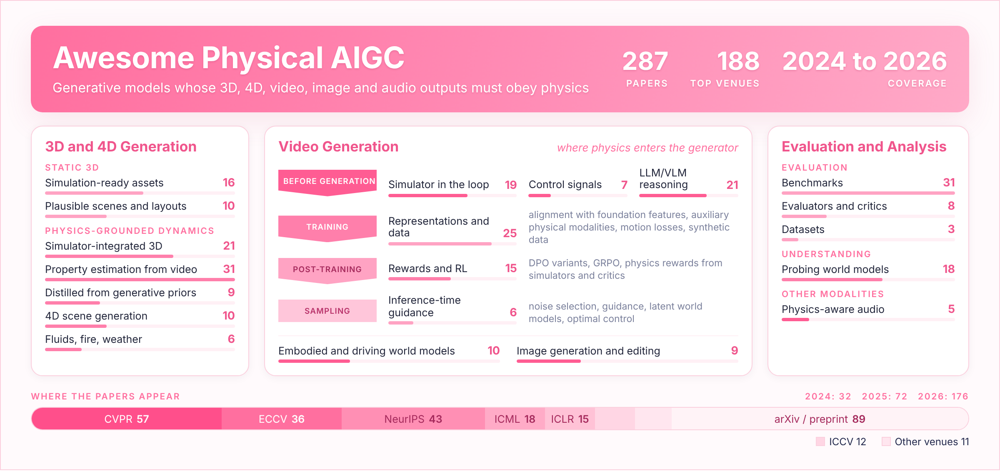

# Awesome Physical AIGC [](https://awesome.re)

A curated list of **physics-aware AI-generated content (AIGC)**: generative models whose outputs (3D assets, 4D scenes, videos, images, audio) must obey physical dynamics, and the benchmarks and analyses that test them. This repository accompanies our IJCAI 2025 survey.

<p align="center"></p>

<p align="center">
  <h2 align="center">Grounding Creativity in Physics: A Brief Survey of Physical Priors in AIGC
  <a href="https://arxiv.org/abs/2502.07007"></a>
  </h2>
</p>
<p align="center">
  <a>Siwei Meng<sup>1</sup></a>,
  <a>Yawei Luo<sup>2</sup></a>,
  <a href="https://pinglmlcv.github.io/pingliu264/">Ping Liu<sup>1</sup></a>
</p>
<p align="center">
  <sup>1</sup><a href="https://www.unr.edu/cse">Department of Computer Science and Engineering, University of Nevada, Reno</a><br>
  <sup>2</sup><a href="http://www.cst.zju.edu.cn/cstenglish/main.htm">School of Software Technology, Zhejiang University</a>
</p>

If you know of work that should be listed, or a preprint that has since been accepted, please open an issue or a pull request, or email us (siweim@unr.edu, yaweiluo@zju.edu.cn, pingl@unr.edu).

## News

* [2026.11] 🔥 The list has been reorganized around a new taxonomy and now covers **284** papers, **187** of them published at top venues (2024 to 2026).
* [2026.11] 🔥 New: [PhyMetric](https://neurips.cc/virtual/2026/poster/139124) (NeurIPS 2026), diagnoses the physical plausibility of text-to-video outputs through scene-level question answering.
* [2026.11] 🔥 New: [PhyMAGIC](https://arxiv.org/abs/2505.16456) (ECCV 2026), generates physically plausible motion from a single image with confidence-guided VLM reasoning.
* [2026.11] 🔥 New: [Physical and Semantic DPO](https://arxiv.org/abs/2607.16947) (ACM MM 2026), aligns text-to-video models with physical preferences under semantic constraints.
* [2025.04] 🔥 Our survey **Grounding Creativity in Physics: A Brief Survey of Physical Priors in AIGC** has been accepted by the IJCAI 2025 Survey Track.

## Scope and Inclusion

- **In scope:** generation whose output must respect physical dynamics or mechanics (motion, forces, materials, contact, fluids), the evaluation of such generation, and analyses of what video and world models know about physics.
- **Out of scope:** physically-based rendering and relighting, scientific machine learning (PDE solvers, neural operators), physics-based character control, and LLM-only physics question answering.
- **Inclusion:** papers published at top venues from 2024 to 2026, plus arXiv preprints (2024 to 2026). Blue badges mark peer-reviewed venues, gray badges mark workshops, posters and findings tracks, and red badges mark preprints. Within each category, papers are sorted by venue tier and then by year (newest first).

## Contents

- [Surveys](#surveys)
- [Physics-Aware Static 3D Generation](#physics-aware-static-3d-generation)
  - [Physically Valid and Simulation-Ready Assets](#physically-valid-and-simulation-ready-assets)
  - [Physically Plausible Scene and Layout Generation](#physically-plausible-scene-and-layout-generation)
- [Physics-Grounded 3D and 4D Dynamics](#physics-grounded-3d-and-4d-dynamics)
  - [Simulation-Integrated 3D Representations](#simulation-integrated-3d-representations)
  - [Physical Property Estimation from Videos](#physical-property-estimation-from-videos)
  - [Physics Distilled from Generative Priors](#physics-distilled-from-generative-priors)
  - [Physics-Aware 4D Scene Generation](#physics-aware-4d-scene-generation)
  - [Fluids, Fire, Weather and Other Phenomena](#fluids-fire-weather-and-other-phenomena)
- [Physics-Aware Video Generation](#physics-aware-video-generation)
  - [Simulation-in-the-Loop and Explicit Dynamics](#simulation-in-the-loop-and-explicit-dynamics)
  - [Physical Control Signals](#physical-control-signals)
  - [LLM/VLM Reasoning and Agentic Planning](#llmvlm-reasoning-and-agentic-planning)
  - [Physics-Aware Representations, Objectives and Data](#physics-aware-representations-objectives-and-data)
  - [Post-Training with Physics Rewards, Preferences and RL](#post-training-with-physics-rewards-preferences-and-rl)
  - [Inference-Time Guidance and Refinement](#inference-time-guidance-and-refinement)
  - [Embodied, Driving and Human-Object Interaction World Models](#embodied-driving-and-human-object-interaction-world-models)
- [Physics-Aware Image Generation and Editing](#physics-aware-image-generation-and-editing)
- [Physics-Aware Audio Generation](#physics-aware-audio-generation)
- [Evaluation](#evaluation)
  - [Benchmarks](#benchmarks)
  - [Automatic Evaluators, Critics and Detectors](#automatic-evaluators-critics-and-detectors)
  - [Datasets](#datasets)
- [Physical Understanding in Video and World Models](#physical-understanding-in-video-and-world-models)
- [Related Awesome Lists](#related-awesome-lists)
- [Citation](#citation)

### Taxonomy at a Glance

| Section | Sub-category | Papers |
|:--|:--|--:|
| Surveys | | 7 |
| Physics-Aware Static 3D Generation | Physically Valid and Simulation-Ready Assets | 16 |
|  | Physically Plausible Scene and Layout Generation | 10 |
| Physics-Grounded 3D and 4D Dynamics | Simulation-Integrated 3D Representations | 21 |
|  | Physical Property Estimation from Videos | 31 |
|  | Physics Distilled from Generative Priors | 9 |
|  | Physics-Aware 4D Scene Generation | 10 |
|  | Fluids, Fire, Weather and Other Phenomena | 6 |
| Physics-Aware Video Generation | Simulation-in-the-Loop and Explicit Dynamics | 18 |
|  | Physical Control Signals | 7 |
|  | LLM/VLM Reasoning and Agentic Planning | 20 |
|  | Physics-Aware Representations, Objectives and Data | 25 |
|  | Post-Training with Physics Rewards, Preferences and RL | 15 |
|  | Inference-Time Guidance and Refinement | 6 |
|  | Embodied, Driving and Human-Object Interaction World Models | 10 |
| Physics-Aware Image Generation and Editing | | 9 |
| Physics-Aware Audio Generation | | 5 |
| Evaluation | Benchmarks | 30 |
|  | Automatic Evaluators, Critics and Detectors | 8 |
|  | Datasets | 3 |
| Physical Understanding in Video and World Models | | 18 |

---

## Surveys

-  🔥 **Grounding Creativity in Physics: A Brief Survey of Physical Priors in AIGC** [[Paper]](https://arxiv.org/abs/2502.07007)
-  🔥 **Physics-Informed Computer Vision: A Review and Perspectives** [[Paper]](https://arxiv.org/abs/2305.18035)
-  🔥 **Advances in 4D Generation: A Survey** [[Paper]](https://arxiv.org/abs/2503.14501)
-  🔥 **Aligning Perception, Reasoning, Modeling and Interaction: A Survey on Physical AI** [[Paper]](https://arxiv.org/abs/2510.04978)
-  🔥 **Exploring the Evolution of Physics Cognition in Video Generation: A Survey** [[Paper]](https://arxiv.org/abs/2503.21765)
-  🔥 **Generative Physical AI in Vision: A Survey** [[Paper]](https://arxiv.org/abs/2501.10928)
-  🔥 **Simulating the Visual World with Artificial Intelligence: A Roadmap** [[Paper]](https://arxiv.org/abs/2511.08585)

[⬆ Back to top](#contents)

## Physics-Aware Static 3D Generation

Assets and scenes that must stand, assemble, or be simulated: physical validity is a constraint on the generated geometry.

### Physically Valid and Simulation-Ready Assets

Single objects whose geometry or material is optimized or checked for stability, buildability, or simulation readiness.

-  🔥 **PhysGen: Physically Grounded 3D Shape Generation for Industrial Design** [[Paper]](https://arxiv.org/abs/2512.00422) [[Code]](https://github.com/kasvii/PhysGen)
-  🔥 **PhysX-Anything: Simulation-Ready Physical 3D Assets from Single Image** [[Paper]](https://arxiv.org/abs/2511.13648)
-  🔥 **AutoPhyX: Automatic Text-Condition Physics Property Generation** [[Paper]](https://radiancefields.com/papers/autophyx-automatic-text-condition-physics-property-generation)
-  🔥 **PhysForge: Generating Physics-Grounded 3D Assets for Interactive Virtual World** [[Paper]](https://openreview.net/forum?id=BBIcqAryty)
-  🔥 **DSO: Aligning 3D Generators with Simulation Feedback for Physical Soundness** [[Paper]](https://arxiv.org/abs/2503.22677)
-  🔥 **Generating Physically Stable and Buildable Brick Structures from Text** [[Paper]](https://arxiv.org/abs/2505.05469)
-  🔥 **Guiding Diffusion-Based Articulated Object Generation by Partial Point Cloud Alignment and Physical Plausibility Constraints** [[Paper]](https://arxiv.org/abs/2508.00558)
-  🔥 **Generating Physically Sound Designs from Text and a Set of Physical Constraints** [[Paper]](https://openreview.net/forum?id=eZIqkDf8m2)
-  🔥 **PhysX-3D: Physical-Grounded 3D Asset Generation** *(Spotlight)* [[Paper]](https://openreview.net/forum?id=hLJLP3CmHR)
-  🔥 **Dress-1-to-3: Single Image to Simulation-Ready 3D Outfit with Diffusion Prior and Differentiable Physics** [[Paper]](https://arxiv.org/abs/2502.03449)
-  🔥 **GPLD3D: Latent Diffusion of 3D Shape Generative Models by Enforcing Geometric and Physical Priors** [[Paper]](https://openaccess.thecvf.com/content/CVPR2024/html/Dong_GPLD3D_Latent_Diffusion_of_3D_Shape_Generative_Models_by_Enforcing_CVPR_2024_paper.html)
-  🔥 **Tree-D Fusion: Simulation-Ready Tree Dataset from Single Images with Diffusion Priors** [[Paper]](https://www.ecva.net/papers/eccv_2024/papers_ECCV/html/5802_ECCV_2024_paper.php)
-  🔥 **Atlas3D: Physically Constrained Self-Supporting Text-to-3D for Simulation and Fabrication** [[Paper]](https://arxiv.org/abs/2405.18515)
-  🔥 **Physically Compatible 3D Object Modeling from a Single Image** *(Spotlight)* [[Paper]](https://arxiv.org/abs/2405.20510)
-  🔥 **LLM-to-Phy3D: Physically Conform Online 3D Object Generation with LLMs** [[Paper]](https://arxiv.org/abs/2506.11148)
-  🔥 **PhyCAGE: Physically Plausible Compositional 3D Asset Generation from a Single Image** [[Paper]](https://arxiv.org/abs/2411.18548)

### Physically Plausible Scene and Layout Generation

Multi-object scenes and layouts with contact, support, and collision constraints.

-  🔥 **Inclusive Interactive Collisions for Multi-View Consistent Compositional 3D Generation** [[Paper]](https://arxiv.org/abs/2606.24206)
-  🔥 **PAT3D: Physics-Augmented Text-to-3D Scene Generation** [[Paper]](https://openreview.net/forum?id=iIRxFkeCuY)
-  🔥 **PhyScensis: Physics-Augmented LLM Agents for Complex Physical Scene Arrangement** [[Paper]](https://openreview.net/forum?id=aCVfhY4Qen)
-  🔥 **PhyScene3D: Physically Consistent 3D Interactive Tabletop Scene Generation** [[Paper]](https://openreview.net/forum?id=T4A2aYyaq9)
-  🔥 **SceneSmith: Agentic Generation of Simulation-Ready Indoor Scenes** *(Spotlight)* [[Paper]](https://openreview.net/forum?id=WwS8CTpUA6)
-  🔥 **STABLE: Simulation-Ready Tabletop Layout Generation via a Semantics-Physics Dual System** [[Paper]](https://openreview.net/forum?id=pGpEGZhL7Y)
-  🔥 **HoloScene: Simulation-Ready Interactive 3D Worlds from a Single Video** [[Paper]](https://openreview.net/forum?id=BOwPpmRgmW)
-  🔥 **PhyScene: Physically Interactable 3D Scene Synthesis for Embodied AI** *(Highlight)* [[Paper]](https://arxiv.org/abs/2404.09465) [[Code]](https://physcene.github.io)
-  🔥 **LayoutDreamer: Physics-guided Layout for Text-to-3D Compositional Scene Generation** [[Paper]](https://arxiv.org/abs/2502.01949)
-  🔥 **PhiP-G: Physics-Guided Text-to-3D Compositional Scene Generation** [[Paper]](https://arxiv.org/abs/2502.00708)

[⬆ Back to top](#contents)

## Physics-Grounded 3D and 4D Dynamics

A 3D representation is coupled with a physical model so that it moves under forces. Sub-categories follow where the physical parameters come from.

### Simulation-Integrated 3D Representations

Gaussians, NeRFs, or meshes driven by a physics solver (MPM, PBD, FEM, spring-mass) with user- or text-specified materials.

-  🔥 **GaussianFluent: Gaussian Simulation for Dynamic Scenes with Mixed Materials** [[Paper]](https://arxiv.org/abs/2601.09265)
-  🔥 **Perceptual 3D Simulation with Physical World Modeling** [[Paper]](https://arxiv.org/abs/2606.27575)
-  🔥 **Boba: Batched Simulation for Physics-Based Gaussian Digital Twins** [[Paper]](https://link.springer.com/chapter/10.1007/978-3-032-37553-7_12) [[Code]](https://github.com/jianxiapyh/Boba-Public)
-  🔥 **MeGAS: Thermomechanical Dynamic Gaussian Splatting for Thermophysical Scene Editing** [[Paper]](https://arxiv.org/abs/2606.23455) [[Project]](https://zju3dv.github.io/MeGAS/)
-  🔥 **Efficient and Robust Physical 3DGS-MPM Simulation via Interior Filling and Text-Physics Optimization** [[Paper]](https://neurips.cc/virtual/2026/poster/149910)
-  🔥 **Fracture-GS: Dynamic Fracture Simulation with Physics-Integrated Gaussian Splatting** [[Paper]](https://openreview.net/forum?id=zcAwK50ft0)
-  🔥 **DecoupledGaussian: Object-Scene Decoupling for Physics-Based Interaction** [[Paper]](https://arxiv.org/abs/2503.05484) [[Code]](https://wangmiaowei.github.io/DecoupledGaussian.github.io/)
-  🔥 **Gaussian Splashing: Unified Particles for Versatile Motion Synthesis and Rendering** [[Paper]](https://arxiv.org/abs/2401.15318)
-  🔥 **GausSim: Foreseeing Reality by Gaussian Simulator for Elastic Objects** [[Paper]](https://arxiv.org/abs/2412.17804)
-  🔥 **MaGS: Reconstructing and Simulating Dynamic 3D Objects with Mesh-adsorbed Gaussian Splatting** [[Paper]](https://arxiv.org/abs/2406.01593)
-  🔥 **PhysSplat: Efficient Physics Simulation for 3D Scenes via MLLM-Guided Gaussian Splatting** [[Paper]](https://openaccess.thecvf.com/content/ICCV2025/html/Zhao_PhysSplat_Efficient_Physics_Simulation_for_3D_Scenes_via_MLLM-Guided_Gaussian_ICCV_2025_paper.html)
-  🔥 **MPMAvatar: Learning 3D Gaussian Avatars with Accurate and Robust Physics-Based Dynamics** [[Paper]](https://openreview.net/forum?id=Qr0YbuilFb)
-  🔥 **PhysGaussian: Physics-Integrated 3D Gaussians for Generative Dynamics** *(Highlight)* [[Paper]](https://arxiv.org/abs/2311.12198)
-  🔥 **PIE-NeRF: Physics-based Interactive Elastodynamics with NeRF** [[Paper]](https://arxiv.org/abs/2311.13099)
-  🔥 **Language-Driven Physics-Based Scene Synthesis and Editing via Feature Splatting** [[Paper]](https://www.ecva.net/papers/eccv_2024/papers_ECCV/html/5788_ECCV_2024_paper.php)
-  🔥 **PhysAvatar: Learning the Physics of Dressed 3D Avatars from Visual Observations** [[Paper]](https://www.ecva.net/papers/eccv_2024/papers_ECCV/html/5446_ECCV_2024_paper.php)
-  🔥 **LiveScene: Language Embedding Interactive Radiance Fields for Physical Scene Control and Rendering** [[Paper]](https://neurips.cc/virtual/2024/poster/95700)
-  🔥 **VR-GS: A Physical Dynamics-aware Interactive Gaussian Splatting System in Virtual Reality** [[Paper]](https://arxiv.org/abs/2401.16663)
-  🔥 **PhysTalk: Language-driven Real-time Physics in 3D Gaussian Scenes** [[Paper]](https://arxiv.org/abs/2512.24986)
-  🔥 **PIG: Physically-based Multi-Material Interaction with 3D Gaussians** [[Paper]](https://arxiv.org/abs/2506.07657)
-  🔥 **GASP: Gaussian Splatting for Physic-Based Simulations** [[Paper]](https://arxiv.org/abs/2409.05819) [[Project]](https://waczjoan.github.io/GASP/)

### Physical Property Estimation from Videos

System identification: material parameters, constitutive laws, or learned simulators are recovered from observed videos.

-  🔥 **GenMatter: Perceiving Physical Objects with Generative Matter Models** [[Paper]](https://arxiv.org/abs/2604.22160)
-  🔥 **ParticleGS: Learning Neural Gaussian Particle Dynamics from Videos for Prior-free Physical Motion Extrapolation** [[Paper]](https://arxiv.org/abs/2505.20270)
-  🔥 **PhysHO: Physics-Based Dynamic 3D Gaussian Human and Object from Monocular Video** [[Paper]](https://suezjiang.github.io/physho/)
-  🔥 **UniPixie: Unified and Probabilistic 3D Physics Learning via Flow Matching** [[Paper]](https://arxiv.org/abs/2606.05399) [[Project]](https://unipixie.github.io/)
-  🔥 **NeuIDO: Neural Intrinsic Dynamics Operator for Physics-Informed 4D World Models** [[Paper]](https://arxiv.org/abs/2609.24313)
-  🔥 **PhysConvex: Physics-Informed Dynamic Convex Fields for Reconstruction and Simulation** [[Paper]](https://arxiv.org/abs/2602.18886)
-  🔥 **ReconPhys: Reconstruct Appearance and Physical Attributes from Single Video** [[Paper]](https://arxiv.org/abs/2604.07882)
-  🔥 **MonoPhysics: Estimating Geometry, Appearance, and Physical Parameters from Monocular Videos** [[Paper]](https://neurips.cc/virtual/2026/poster/151413)
-  🔥 **NEXUS: Neural Energy Fields for Physically Consistent Contact-Rich 3D Object Dynamics** [[Paper]](https://arxiv.org/abs/2606.15015)
-  🔥 **PhyMo: Learning Physical Dynamics with Accurate and Continuous Motion from Multi-View Videos** [[Paper]](https://neurips.cc/virtual/2026/poster/154704)
-  🔥 **PHYSIFORMER: Learning to Simulate Mechanics in World Space** [[Paper]](https://neurips.cc/virtual/2026/poster/155354)
-  🔥 **CloDS: Visual-Only Unsupervised Cloth Dynamics Learning in Unknown Conditions** [[Paper]](https://openreview.net/forum?id=Wj5qJnS1zW)
-  🔥 **DiffWind: Physics-Informed Differentiable Modeling of Wind-Driven Object Dynamics** [[Paper]](https://openreview.net/forum?id=vKVzihkbQo)
-  🔥 **Learning Physics-Grounded 4D Dynamics with Neural Gaussian Force Fields** [[Paper]](https://arxiv.org/abs/2602.00148)
-  🔥 **Learning 3D-Gaussian Simulators from RGB Videos** [[Paper]](https://openreview.net/forum?id=Icj19tWHI1)
-  🔥 **Physics-Informed Deformable Gaussian Splatting: Towards Unified Constitutive Laws for Time-Evolving Material Field** [[Paper]](https://arxiv.org/abs/2511.06299)
-  🔥 **Seeing is Simulating: Differentiable Physics for Interaction-Aware Material Estimation** [[Paper]](https://arxiv.org/abs/2603.06022)
-  🔥 **FreeGave: 3D Physics Learning from Dynamic Videos by Gaussian Velocity** [[Paper]](https://openaccess.thecvf.com/content/CVPR2025/html/Li_FreeGave_3D_Physics_Learning_from_Dynamic_Videos_by_Gaussian_Velocity_CVPR_2025_paper.html)
-  🔥 **Vid2Sim: Generalizable, Video-based Reconstruction of Appearance, Geometry and Physics for Mesh-free Simulation** [[Paper]](https://arxiv.org/abs/2506.06440) [[Code]](https://czzzzh.github.io/Vid2Sim)
-  🔥 **PhysTwin: Physics-Informed Reconstruction and Simulation of Deformable Objects from Videos** [[Paper]](https://arxiv.org/abs/2503.17973)
-  🔥 **TRACE: Learning 3D Gaussian Physical Dynamics from Multi-view Videos** [[Paper]](https://arxiv.org/abs/2508.09811)
-  🔥 **Gaussian-Augmented Physics Simulation and System Identification with Complex Colliders** [[Paper]](https://openreview.net/forum?id=hvykiwFiF8)
-  🔥 **Improving Physics-Augmented Continuum Neural Radiance Field-Based Geometry-Agnostic System Identification with Lagrangian Particle Optimization** [[Paper]](https://arxiv.org/abs/2406.04155)
-  🔥 **Reconstruction and Simulation of Elastic Objects with Spring-Mass 3D Gaussians** [[Paper]](https://arxiv.org/abs/2403.09434)
-  🔥 **Gaussian-Informed Continuum for Physical Property Identification and Simulation** *(Oral)* [[Paper]](https://arxiv.org/abs/2406.14927)
-  🔥 **NeuMA: Neural Material Adaptor for Visual Grounding of Intrinsic Dynamics** [[Paper]](https://arxiv.org/abs/2410.08257)
-  🔥 **M-PhyGs: Multi-Material Object Dynamics from Video** [[Paper]](https://arxiv.org/abs/2512.16885)
-  🔥 **Analytic Dynamics: Learning Physics-Grounded Representation for Fast Intrinsic Dynamics Inference from Monocular Videos** [[Paper]](https://arxiv.org/abs/2608.31025)
-  🔥 **Learning Physics-Guided Residual Dynamics for Deformable Object Simulation** [[Paper]](https://arxiv.org/abs/2607.13451) [[Project]](https://pgrd-robot.github.io/)
-  🔥 **PhysCoRe: Physics-Corrected Residual World Models for Material-Aware Deformable Dynamics** [[Paper]](https://arxiv.org/abs/2607.20653)
-  🔥 **PhysWorld: From Real Videos to World Models of Deformable Objects via Physics-Aware Demonstration Synthesis** [[Paper]](https://arxiv.org/abs/2510.21447)

### Physics Distilled from Generative Priors

Material and motion are supplied by video diffusion models, LLMs, or VLMs instead of observed dynamics.

-  🔥 **PhysGM: Large Physical Gaussian Model for Feed-Forward 4D Synthesis** [[Paper]](https://arxiv.org/abs/2508.13911)
-  🔥 **Unleashing the Potential of Multi-modal Foundation Models and Video Diffusion for 4D Dynamic Physical Scene Simulation** [[Paper]](https://arxiv.org/abs/2411.14423) [[Code]](https://zhuomanliu.github.io/PhysFlow)
-  🔥 **GaussianProperty: Integrating Physical Properties to 3D Gaussians with LMMs** [[Paper]](https://arxiv.org/abs/2412.11258)
-  🔥 **OmniPhysGS: 3D Constitutive Gaussians for General Physics-Based Dynamics Generation** [[Paper]](https://arxiv.org/abs/2501.18982)
-  🔥 **DreamPhysics: Learning Physics-Based 3D Dynamics with Video Diffusion Priors** [[Paper]](https://arxiv.org/abs/2406.01476) [[Code]](https://github.com/tyhuang0428/DreamPhysics)
-  🔥 **PhysDreamer: Physics-Based Interaction with 3D Objects via Video Generation** *(Oral)* [[Paper]](https://arxiv.org/abs/2404.13026)
-  🔥 **AgentDreamer: Agentic 3D Motion Reasoning for Text-Controllable Physics Simulation** [[Paper]](https://arxiv.org/abs/2610.30679) [[Code]](https://github.com/mjmjeong/AgentDreamer)
-  🔥 **Physics3D: Learning Physical Properties of 3D Gaussians via Video Diffusion** [[Paper]](https://arxiv.org/abs/2406.04338) [[Project]](https://liuff19.github.io/Physics3D/)
-  🔥 **PhysMotion: Physics-Grounded Dynamics From a Single Image** [[Paper]](https://arxiv.org/abs/2411.17189) [[Project]](https://supertan0204.github.io/physmotion_website/)

### Physics-Aware 4D Scene Generation

Generation of dynamic 3D scenes (multi-object, long-horizon, or action-conditioned) with physical interaction.

-  🔥 **Choreographing a World of Dynamic Objects** [[Paper]](https://arxiv.org/abs/2601.04194)
-  🔥 **PerpetualWonder: Long-horizon Action-conditioned 4D Scene Generation** [[Paper]](https://arxiv.org/abs/2602.04876)
-  🔥 **SeeU: Seeing the Unseen World via 4D Dynamics-aware Generation** [[Paper]](https://arxiv.org/abs/2512.03350)
-  🔥 **CP4D: Compositional Physics-aware 4D Scene Generation** [[Paper]](https://arxiv.org/abs/2606.09187)
-  🔥 **GS-Agent: Creating 4D Physical Worlds With Generative Simulation** [[Paper]](https://arxiv.org/abs/2607.21522)
-  🔥 **Phys4D: Fine-Grained Physics-Consistent 4D Modeling from Video Diffusion** [[Paper]](https://arxiv.org/abs/2603.03485)
-  🔥 **Resonance4D: Frequency-Domain Motion Supervision for Preset-Free Physical Parameter Learning in 4D Dynamic Physical Scene Simulation** [[Paper]](https://arxiv.org/abs/2604.01994)
-  🔥 **Phy124: Fast Physics-Driven 4D Content Generation from a Single Image** [[Paper]](https://arxiv.org/abs/2409.07179)
-  🔥 **Phys4DGen: A Physics-Driven Framework for Controllable and Efficient 4D Content Generation from a Single Image** [[Paper]](https://arxiv.org/abs/2411.16800) [[Code]](https://github.com/JiajingLin/Phys4DGen)
-  🔥 **Trans4D: Realistic Geometry-Aware Transition for Compositional Text-to-4D Synthesis** [[Paper]](https://arxiv.org/abs/2410.07155)

### Fluids, Fire, Weather and Other Phenomena

Natural phenomena that require dedicated solvers or priors.

-  🔥 **Let it Snow! Animating 3D Gaussian Scenes with Dynamic Weather Effects via Physics-Guided Score Distillation** [[Paper]](https://arxiv.org/abs/2504.05296)
-  🔥 **SmokeSVD: Smoke Reconstruction from A Single View via Progressive Novel View Synthesis and Refinement with Diffusion Models** *(Oral)* [[Paper]](https://arxiv.org/abs/2507.12156)
-  🔥 **FieryGS: In-the-Wild Fire Synthesis with Physics-Integrated Gaussian Splatting** [[Paper]](https://openreview.net/forum?id=ziKFH7whvy)
-  🔥 **FluidNexus: 3D Fluid Reconstruction and Prediction from a Single Video** [[Paper]](https://arxiv.org/abs/2503.04720)
-  🔥 **RainyGS: Efficient Rain Synthesis with Physically-Based Gaussian Splatting** [[Paper]](https://arxiv.org/abs/2503.21442)
-  🔥 **Vid2Fluid: 3D Dynamic Fluid Assets from Single-View Videos with Generative Gaussian Splatting** [[Paper]](https://arxiv.org/abs/2503.00868)

[⬆ Back to top](#contents)

## Physics-Aware Video Generation

Organized by how physics enters the video generator.

### Simulation-in-the-Loop and Explicit Dynamics

An explicit simulator or a learned dynamics module produces the motion, and the video model renders it.

-  🔥 **NS-Diff: Fluid Navier-Stokes Guided Video Diffusion via Reinforcement Learning** [[Paper]](https://cvpr.thecvf.com/virtual/2026/poster/36346)
-  🔥 **Physical Simulator In-the-Loop Video Generation** [[Paper]](https://arxiv.org/abs/2603.06408)
-  🔥 **KineMask: Learning to Generate Rigid Body Interactions with Video Diffusion Models** [[Paper]](https://arxiv.org/abs/2510.02284) [[Project]](https://daromog.github.io/KineMask)
-  🔥 **PhysChoreo: Physics-Controllable Video Generation with Part-Aware Semantic Grounding** [[Paper]](https://arxiv.org/abs/2511.20562)
-  🔥 **NewtonGen: Physics-consistent and Controllable Text-to-Video Generation via Neural Newtonian Dynamics** [[Paper]](https://arxiv.org/abs/2509.21309)
-  🔥 **PhysAnimator: Physics-Guided Generative Cartoon Animation** [[Paper]](https://arxiv.org/abs/2501.16550)
-  🔥 **Learning an Implicit Physics Model for Image-based Fluid Simulation** [[Paper]](https://arxiv.org/abs/2508.08254)
-  🔥 **PhysCtrl: Generative Physics for Controllable and Physics-Grounded Video Generation** [[Paper]](https://arxiv.org/abs/2509.20358)
-  🔥 **Generative Image Dynamics** [[Paper]](https://arxiv.org/abs/2309.07906)
-  🔥 **PhysGen: Rigid-Body Physics-Grounded Image-to-Video Generation** [[Paper]](https://arxiv.org/abs/2409.18964)
-  🔥 **MotionCraft: Physics-Based Zero-Shot Video Generation** [[Paper]](https://arxiv.org/abs/2405.13557)
-  🔥 **ANFluid: Animate Natural Fluid Photos base on Physics-Aware Simulation and Dual-Flow Texture Learning** [[Paper]](https://initialmoon.github.io/publications/anfluid/)
-  🔥 **Sketch-based Fluid Video Generation Using Motion-Guided Diffusion Models in Still Landscape Images** [[Paper]](https://arxiv.org/abs/2510.15874)
-  🔥 **Counterfactual Simulation-Guided Physical Reasoning for Physics-Based Video Generation** [[Paper]](https://scholar.google.com/scholar?q=%22Counterfactual+Simulation-Guided+Physical+Reasoning+for+Physics-Based+Video+Generation%22)
-  🔥 **IMPACT: Image-Conditioned Motion with Physics-Aware Collision and Trajectory Guidance for Video Generation** [[Paper]](https://arxiv.org/abs/2611.01372)
-  🔥 **PhyRPR: Training-Free Physics-Constrained Video Generation** [[Paper]](https://arxiv.org/abs/2601.09255)
-  🔥 **RealWonder: Real-Time Physical Action-Conditioned Video Generation** [[Paper]](https://arxiv.org/abs/2603.05449)
-  🔥 **Physics-Grounded Motion Forecasting via Equation Discovery for Trajectory-Guided Image-to-Video Generation** [[Paper]](https://arxiv.org/abs/2507.06830)

### Physical Control Signals

The generator is conditioned on forces, physical parameters, or physics-derived flow.

-  🔥 **GoalForce: Teaching Video Models to Accomplish Physics-Conditioned Goals** [[Paper]](https://arxiv.org/abs/2601.05848)
-  🔥 **PhyCo: Learning Controllable Physical Priors for Generative Motion** [[Paper]](https://arxiv.org/abs/2604.28169)
-  🔥 **Force Prompting: Video Generation Models Can Learn and Generalize Physics-based Control Signals** [[Paper]](https://arxiv.org/abs/2505.19386)
-  🔥 **Learning Explicit Physical Parameter Control and Benchmarking for Video Generation** [[Paper]](https://arxiv.org/abs/2607.18924)
-  🔥 **PhysFlow: Physics-Aware Optical Flow for Motion Controllable Video Generation** [[Paper]](https://arxiv.org/abs/2609.08215)
-  🔥 **PhysStream: Streaming Physics-Grounded Video Generation with Structured Scene Memory and Fine-Grained Motion Control** [[Paper]](https://arxiv.org/abs/2609.17521)
-  🔥 **StreamForce: Streaming Video Generation with Streaming Force Control** [[Paper]](https://arxiv.org/abs/2606.07508) [[Project]](https://neu-vi.github.io/StreamForce/)

### LLM/VLM Reasoning and Agentic Planning

A language or vision-language model reasons about the physical process (plans, keyframes, trajectories, retrieved exemplars, code) before or during generation.

-  🔥 **Chain of Event-Centric Causal Thought for Physically Plausible Video Generation** [[Paper]](https://arxiv.org/abs/2603.09094)
-  🔥 **MoReGen: Multi-Agent Motion-Reasoning Engine for Code-based Text-to-Video Synthesis** [[Paper]](https://arxiv.org/abs/2512.04221)
-  🔥 **DeforM: Reasoning-Guided Physics-Aware Video Generation via Spatial-Temporal Masking** [[Paper]](https://arxiv.org/abs/2607.18664)
-  🔥 **PhyMAGIC: Physical Motion-Aware Generative Inference with Confidence-guided VLM** [[Paper]](https://arxiv.org/abs/2505.16456)
-  🔥 **PhysRAG: Enhancing Physics-Awareness in Video Generation via Retrieval-Augmented Generation** [[Paper]](https://arxiv.org/abs/2606.26916)
-  🔥 **PhyT2V: LLM-Guided Iterative Self-Refinement for Physics-Grounded Text-to-Video Generation** [[Paper]](https://arxiv.org/abs/2412.00596)
-  🔥 **VLIPP: Towards Physically Plausible Video Generation with Vision and Language Informed Physical Prior** [[Paper]](https://arxiv.org/abs/2503.23368)
-  🔥 **Agentic Physics-Grounded Video Generation via Memory-Augmented In-Context Reasoning** [[Paper]](https://arxiv.org/abs/2610.23677) [[Code]](https://github.com/xxkkxxx/PhysRepair)
-  🔥 **CausalMotion: Structured Physical Reasoning as Keyframe and Trajectory Guidance for Training-Free Video Generation** [[Paper]](https://arxiv.org/abs/2606.14317) [[Project]](https://zhuangsh0713.github.io/CausalMotion/)
-  🔥 **NEWTON: Agentic Planning for Physically Grounded Video Generation** [[Paper]](https://arxiv.org/abs/2605.18396)
-  🔥 **PhyEvolve: Multi-Agent State-Evolution Planning for Physics-Aware Video Generation** [[Paper]](https://arxiv.org/abs/2610.30717) [[Code]](https://github.com/PhyEvolve/PhyEvolve)
-  🔥 **PhyPrompt: RL-based Prompt Refinement for Physically Plausible Text-to-Video Generation** [[Paper]](https://arxiv.org/abs/2603.03505)
-  🔥 **PhysAgent: Reflective Agentic Physics Control for Physically Plausible Video Generation** [[Paper]](https://arxiv.org/abs/2607.16355)
-  🔥 **Physics-Aware Video Generation via Agentic Planning and Graph-Guided Optimization** [[Paper]](https://arxiv.org/abs/2609.13006)
-  🔥 **PhysMRV: Physical Memory Retrieval and Verification for Physics Plausibility Reasoning** [[Paper]](https://arxiv.org/abs/2607.10190)
-  🔥 **VideoCoCo: Code-as-CoT for Physically-Consistent Video Generation via an Agentic Dual-Engine System** [[Paper]](https://arxiv.org/abs/2607.27380)
-  🔥 **VIPER: Visual In-Context Physics Reasoning for Physically Plausible Video Generation** [[Paper]](https://arxiv.org/abs/2607.23472)
-  🔥 **Enhancing Physical Plausibility in Video Generation by Reasoning the Implausibility** [[Paper]](https://arxiv.org/abs/2509.24702)
-  🔥 **Planning with Sketch-Guided Verification for Physics-Aware Video Generation** [[Paper]](https://arxiv.org/abs/2511.17450)
-  🔥 **Think Before You Diffuse: LLMs-Guided Physics-Aware Video Generation** [[Paper]](https://arxiv.org/abs/2505.21653)

### Physics-Aware Representations, Objectives and Data

The generator itself is trained with physics-related representation alignment, auxiliary modalities, losses, or synthetic data.

-  🔥 **Phantom: Physics-Infused Video Generation via Joint Modeling of Visual and Latent Physical Dynamics** [[Paper]](https://arxiv.org/abs/2604.08503)
-  🔥 **PhysVid: Physics Aware Local Conditioning for Generative Video Models** [[Paper]](https://arxiv.org/abs/2603.26285)
-  🔥 **ProPhy: Progressive Physical Alignment for Dynamic World Simulation** [[Paper]](https://arxiv.org/abs/2512.05564)
-  🔥 **UnityVideo: Unified Multi-Modal Multi-Task Learning for Enhancing World-Aware Video Generation** [[Paper]](https://arxiv.org/abs/2512.07831)
-  🔥 **PhysAlign: Learning Physical Priors for Dynamical Event-Driven Video Generation via Representation Alignment** [[Paper]](https://link.springer.com/chapter/10.1007/978-3-032-37464-6_28) [[Code]](https://github.com/FanQi-AI/PhysAlign)
-  🔥 **Predictive Structure Improves Video Diffusion Dynamics** [[Paper]](https://vision.cs.utexas.edu/projects/ldo)
-  🔥 **HiPhy: Hierarchical Alignment for Physically-Plausible Multi-Principle Video Generation** [[Paper]](https://neurips.cc/virtual/2026/poster/150284)
-  🔥 **Physics-Informed Video Generation via Mixture-of-Experts Latent Alignment** [[Paper]](https://neurips.cc/virtual/2026/poster/155222)
-  🔥 **Seeing the Unseen: Unified Visible-Invisible Motion for Physically Consistent Video Generation** [[Paper]](https://neurips.cc/virtual/2026/poster/149881)
-  🔥 **Physics-Guided Motion Loss for Video Generation Model** [[Paper]](https://arxiv.org/abs/2506.02244)
-  🔥 **Synthetic Video Enhances Physical Fidelity in Video Synthesis** [[Paper]](https://arxiv.org/abs/2503.20822)
-  🔥 **GeoVideo: Introducing Geometric Regularization into Video Generation Model** [[Paper]](https://openreview.net/forum?id=be6u40gq0Y)
-  🔥 **Towards Physical Understanding in Video Generation: A 3D Point Regularization Approach** [[Paper]](https://arxiv.org/abs/2502.03639)
-  🔥 **VideoREPA: Learning Physics for Video Generation through Relational Alignment with Foundation Models** [[Paper]](https://arxiv.org/abs/2505.23656)
-  🔥 **WISA: World Simulator Assistant for Physics-Aware Text-to-Video Generation** *(Spotlight)* [[Paper]](https://arxiv.org/abs/2503.08153)
-  🔥 **VideoJAM: Joint Appearance-Motion Representations for Enhanced Motion Generation in Video Models** *(Oral)* [[Paper]](https://arxiv.org/abs/2502.02492)
-  🔥 **CompAdapt: Adaptable Composite Motion Modeling for Physics-Consistent Text-to-Video Generation** [[Paper]](https://arxiv.org/abs/2609.21455)
-  🔥 **Enhancing Video Physical Consistency via Role-aware Joint Training and Modality-decoupled Denoising** [[Paper]](https://arxiv.org/abs/2607.04653)
-  🔥 **LaMo: Self-Supervised Latent Motion Priors for Physical Realism in Video Generation** [[Paper]](https://arxiv.org/abs/2605.23878) [[Project]](https://lamo-ai.github.io/)
-  🔥 **MiMaAlign: Hierarchical Micro-Macro Alignment for Physically Plausible Video Generation** [[Paper]](https://arxiv.org/abs/2610.16482)
-  🔥 **MMPhysVideo: Physically Plausible Video Generation Through Joint RGB-Perception Modeling** [[Paper]](https://arxiv.org/abs/2604.02817)
-  🔥 **Phase-Aware Video Generation for Physics-Grounded Dynamics and Interactions** [[Paper]](https://arxiv.org/abs/2610.11791)
-  🔥 **PhysAlign: Physics-Coherent Image-to-Video Generation through Feature and 3D Representation Alignment** [[Paper]](https://arxiv.org/abs/2603.13770)
-  🔥 **PhysVideo: Physically Plausible Video Generation with Cross-View Geometry Guidance** [[Paper]](https://arxiv.org/abs/2603.18639)
-  🔥 **Tempered Self-Similarity Alignment for Physically Plausible Video Generation** [[Paper]](https://arxiv.org/abs/2605.24962)

### Post-Training with Physics Rewards, Preferences and RL

Fine-tuning with physics-aware rewards, preference optimization (DPO and variants), or reinforcement learning.

-  🔥 **DynamicsBoost: Dynamic Plausible Video Generation via Annotation-Free Continuation Preference Optimization** [[Paper]](https://cvpr.thecvf.com/virtual/2026/poster/38615)
-  🔥 **PhyGDPO: Physics-Aware Groupwise Direct Preference Optimization for Physically Consistent Text-to-Video Generation** [[Paper]](https://arxiv.org/abs/2512.24551)
-  🔥 **PhysPO: Physics-Aware Local Preference Optimization for Physically Consistent Video Diffusion** [[Paper]](https://shanpoyang654.github.io/PhysPO/page.html)
-  🔥 **PhysRVG: Physics-Aware Unified Reinforcement Learning for Video Generative Models** [[Paper]](https://arxiv.org/abs/2601.11087)
-  🔥 **SIFT: Self-Imagination Fine-Tuning for Physically Plausible Motion in Video Diffusion Models** [[Paper]](https://arxiv.org/abs/2606.27741)
-  🔥 **PhyMotion: Structured 3D Motion Reward for Physics-Grounded Human Video Generation** [[Paper]](https://neurips.cc/virtual/2026/poster/149085)
-  🔥 **World-R1: Reinforcing 3D Constraints for Text-to-Video Generation** [[Paper]](https://openreview.net/forum?id=lh0I4rB0I5)
-  🔥 **When Physical Preferences Meet Semantic Constraints: Physical and Semantic Direct Preference Optimization for Text-to-Video Generation** *(Oral)* [[Paper]](https://arxiv.org/abs/2607.16947)
-  🔥 **Hierarchical Fine-grained Preference Optimization for Physically Plausible Video Generation** [[Paper]](https://arxiv.org/abs/2508.10858)
-  🔥 **PISA Experiments: Exploring Physics Post-Training for Video Diffusion Models by Watching Stuff Drop** [[Paper]](https://arxiv.org/abs/2503.09595)
-  🔥 **DiReCT: Disentangled Regularization of Contrastive Trajectories for Physics-Refined Video Generation** [[Paper]](https://arxiv.org/abs/2603.25931)
-  🔥 **PhysCorr: Dual-Reward DPO for Physics-Constrained Text-to-Video Generation with Automated Preference Selection** [[Paper]](https://arxiv.org/abs/2511.03997)
-  🔥 **PhysMaster: Mastering Physical Representation for Video Generation via Reinforcement Learning** [[Paper]](https://arxiv.org/abs/2510.13809)
-  🔥 **RDPO: Real Data Preference Optimization for Physics Consistency Video Generation** [[Paper]](https://arxiv.org/abs/2506.18655)
-  🔥 **Reasoning Physical Video Generation with Diffusion Timestep Tokens via Reinforcement Learning** [[Paper]](https://arxiv.org/abs/2504.15932)

### Inference-Time Guidance and Refinement

Training-free steering at sampling time: noise selection, guidance, scoring, or optimal control.

-  🔥 **Inference-time Physics Alignment of Video Generative Models with Latent World Models** [[Paper]](https://arxiv.org/abs/2601.10553)
-  🔥 **LINA: Learning INterventions Adaptively for Physical Alignment and Generalization in Diffusion Models** [[Paper]](https://arxiv.org/abs/2512.13290) [[Code]](https://github.com/opencausalab/lina)
-  🔥 **OptiWorld: Optimal Control for Video World Generation under Physical Constraints** [[Paper]](https://arxiv.org/abs/2606.00499)
-  🔥 **Proprio: Latent Self-Scoring and Inference-Time Refinement for Physically Plausible Video Generation** [[Paper]](https://neurips.cc/virtual/2026/poster/154132)
-  🔥 **Physics in 2-Steps: Locking Motion Priors Before Visual Refinement Erases Them** [[Paper]](https://openreview.net/forum?id=5f2hxtNqpM)
-  🔥 **Seeking Physics in Diffusion Noise** [[Paper]](https://arxiv.org/abs/2603.14294) [[Project]](https://thegreatestcj.github.io/Physics-in-Noise)

### Embodied, Driving and Human-Object Interaction World Models

Physics-aware video world models for specific domains.

-  🔥 **GenieDrive: Towards Physics-Aware Driving World Model with 4D Occupancy Guided Video Generation** [[Paper]](https://arxiv.org/abs/2512.12751)
-  🔥 **PAM: A Pose-Appearance-Motion Engine for Sim-to-Real HOI Video Generation** [[Paper]](https://arxiv.org/abs/2603.22193)
-  🔥 **Physical Object Understanding with a Physically Controllable World Model** [[Paper]](https://arxiv.org/abs/2606.00439)
-  🔥 **RoboScape: Physics-informed Embodied World Model** *(Spotlight)* [[Paper]](https://arxiv.org/abs/2506.23135)
-  🔥 **CoInteract: Physically-Consistent Human-Object Interaction Video Synthesis via Spatially-Structured Co-Generation** [[Paper]](https://arxiv.org/abs/2604.19636)
-  🔥 **DreamWorld: Unified World Modeling in Video Generation** [[Paper]](https://arxiv.org/abs/2603.00466)
-  🔥 **PhysisForcing: Physics Reinforced World Simulator for Robotic Manipulation** [[Paper]](https://arxiv.org/abs/2606.28128)
-  🔥 **PhyWorld: Physics-Faithful World Model for Video Generation** [[Paper]](https://arxiv.org/abs/2605.19242)
-  🔥 **MIND-V: Hierarchical Video Generation for Long-Horizon Robotic Manipulation with RL-based Physical Alignment** [[Paper]](https://arxiv.org/abs/2512.06628)
-  🔥 **World Models That Know When They Don't Know: Controllable Video Generation with Calibrated Uncertainty** [[Paper]](https://arxiv.org/abs/2512.05927)

[⬆ Back to top](#contents)

## Physics-Aware Image Generation and Editing

Images, and edits to images or videos, whose content must respect physical relations or the outcome of a physical process.

-  🔥 **PhysEdit: Physically Consistent Image Editing via Causal Enforcement** [[Paper]](https://link.springer.com/chapter/10.1007/978-3-032-37023-5_24) [[Code]](https://github.com/HiDream-ai/PhysEdit)
-  🔥 **ChronoEdit: Towards Temporal Reasoning for In-Context Image Editing and World Simulation** [[Paper]](https://openreview.net/forum?id=MbMzoQ91Gk)
-  🔥 **Does FLUX Already Know How to Perform Physically Plausible Image Composition?** [[Paper]](https://openreview.net/forum?id=DcVg87ibK9)
-  🔥 **From Statics to Dynamics: Physics-Aware Image Editing with Latent Transition Priors** [[Paper]](https://openreview.net/forum?id=7YeCG53Bo9)
-  🔥 **PhysicsGen: Can Generative Models Learn from Images to Predict Complex Physical Relations?** [[Paper]](https://arxiv.org/abs/2503.05333)
-  🔥 **AutoVFX: Physically Realistic Video Editing from Natural Language Instructions** [[Paper]](https://arxiv.org/abs/2411.02394)
-  🔥 **Learning Action and Reasoning-Centric Image Editing from Videos and Simulation** *(Spotlight)* [[Paper]](https://neurips.cc/virtual/2024/poster/97473)
-  🔥 **VideoPhysEdit: Physical Counterfactual Video Editing via Rigid-Body Physical Scene Reconstruction** [[Paper]](https://arxiv.org/abs/2609.35134) [[Code]](https://github.com/Hammour-steak/VideoPhysEdit)
-  🔥 **Do-Undo: Generating and Reversing Physical Actions in Vision-Language Models** [[Paper]](https://arxiv.org/abs/2512.13609)

[⬆ Back to top](#contents)

## Physics-Aware Audio Generation

Sound synthesized from physical interactions, materials, or motion.

-  🔥 **PAVAS: Physics-Aware Video-to-Audio Synthesis** *(Oral)* [[Paper]](https://arxiv.org/abs/2512.08282) [[Code]](https://github.com/SonyResearch/PAVAS)
-  🔥 **Hearing Hands: Generating Sounds from Physical Interactions in 3D Scenes** [[Paper]](https://openaccess.thecvf.com/content/CVPR2025/html/Dou_Hearing_Hands_Generating_Sounds_from_Physical_Interactions_in_3D_Scenes_CVPR_2025_paper.html)
-  🔥 **Differentiable Modal Synthesis for Physical Modeling of Planar String Sound and Motion Simulation** [[Paper]](https://neurips.cc/virtual/2024/poster/94184)
-  🔥 **Tora3: Trajectory-Guided Audio-Video Generation with Physical Coherence** [[Paper]](https://arxiv.org/abs/2604.09057)
-  🔥 **SonicGauss: Position-Aware Physical Sound Synthesis for 3D Gaussian Representations** [[Paper]](https://arxiv.org/abs/2507.19835)

[⬆ Back to top](#contents)

## Evaluation

### Benchmarks

Benchmarks that test physical commonsense, laws, or consistency of generated images, videos, 3D/4D content, and edits.

-  🔥 **PAI-Bench: A Comprehensive Benchmark For Physical AI** *(Oral)* [[Paper]](https://arxiv.org/abs/2512.01989)
-  🔥 **PhysGaia: A Physics-Aware Benchmark with Multi-Body Interactions for Dynamic Novel View Synthesis** [[Paper]](https://arxiv.org/abs/2506.02794) [[Project]](https://cv.snu.ac.kr/research/PhysGaia/)
-  🔥 **A Physics-Grounded Benchmark for Multi-Agent Dynamics in World Models** [[Paper]](https://arxiv.org/abs/2606.28757)
-  🔥 **Benchmarking Scientific Understanding and Reasoning for Video Generation using VideoScience-Bench** [[Paper]](https://arxiv.org/abs/2512.02942)
-  🔥 **BeyondMasks: Evaluating Causal and Physical Consistency in Video Object Removal** [[Paper]](https://arxiv.org/abs/2608.20107)
-  🔥 **IRIS: A Real-World Benchmark for Inverse Recovery and Identification of Physical Dynamic Systems from Monocular Video** [[Paper]](https://arxiv.org/abs/2603.16432)
-  🔥 **PhyEditBench: A Real-World Multi-Stage Benchmark for Physics-Aware Image Editing** [[Paper]](https://arxiv.org/abs/2606.26551)
-  🔥 **Physics Question Scene Graph: Fine-grained Evaluation of Physical Plausibility in Text-to-Video Generation** [[Paper]](https://arxiv.org/abs/2606.25306)
-  🔥 **Apple-π: Benchmarking Thinking with Video Towards Law-Grounded Physical Intelligence** [[Paper]](https://neurips.cc/virtual/2026/poster/139053)
-  🔥 **Do Joint Audio-Video Generation Models Understand Physics?** [[Paper]](https://neurips.cc/virtual/2026/poster/139141)
-  🔥 **PhyMetric: Diagnosing Physical Plausibility in Text-to-Video Generation via Scene-Level QA** [[Paper]](https://neurips.cc/virtual/2026/poster/139124)
-  🔥 **Principia: Relational Physics Tests for Video Models** [[Paper]](https://neurips.cc/virtual/2026/poster/139457)
-  🔥 **PhyWorldBench: A Comprehensive Evaluation of Physical Realism in Text-to-Video Models** *(Oral)* [[Paper]](https://arxiv.org/abs/2507.13428)
-  🔥 **VideoPhy-2: A Challenging Action-Centric Physical Commonsense Evaluation in Video Generation** [[Paper]](https://arxiv.org/abs/2503.06800)
-  🔥 **Evaluating Newtonian Mechanics in Video Generative Models with Real Physical Systems** [[Paper]](https://openreview.net/forum?id=f4xAzcMug6)
-  🔥 **VideoPhy: Evaluating Physical Commonsense for Video Generation** [[Paper]](https://arxiv.org/abs/2406.03520)
-  🔥 **Towards World Simulator: Crafting Physical Commonsense-Based Benchmark for Video Generation** [[Paper]](https://arxiv.org/abs/2410.05363)
-  🔥 **WorldSimBench: Towards Video Generation Models as World Simulators** [[Paper]](https://arxiv.org/abs/2410.18072)
-  🔥 **Physics-Aware Video Instance Removal Benchmark** [[Paper]](https://arxiv.org/abs/2604.05898)
-  🔥 **Beyond Rigid: Benchmarking Non-Rigid Video Editing** [[Paper]](https://arxiv.org/abs/2601.18340)
-  🔥 **Beyond Visual Quality: Evaluating Physical Consistency under Ego-Motion with EgoGenEval** [[Paper]](https://arxiv.org/abs/2609.11172)
-  🔥 **CRONOS: Benchmarking Counterfactual Physical Consistency in Video Models** [[Paper]](https://arxiv.org/abs/2605.23699) [[Project]](https://genintel.github.io/CRONOS/)
-  🔥 **MME-CoF-Pro: Evaluating Reasoning Coherence in Video Generative Models with Text and Visual Hints** [[Paper]](https://arxiv.org/abs/2603.20194)
-  🔥 **PhyGround: Benchmarking Physical Reasoning in Generative World Models** [[Paper]](https://arxiv.org/abs/2605.10806)
-  🔥 **PhyRubric: Rubric-Grounded Diagnostic Evaluation of Physical Commonsense in Text-to-Video Generation** [[Paper]](https://arxiv.org/abs/2611.13576)
-  🔥 **Physion-Eval: Evaluating Physical Realism in Generated Video via Human Reasoning** [[Paper]](https://arxiv.org/abs/2603.19607)
-  🔥 **PVBench: Quantifying Physical Plausibility in Video Generation with Object-Level Physical Measurements** [[Paper]](https://arxiv.org/abs/2610.26711) [[Code]](https://github.com/KSZG-11/PVBench)
-  🔥 **Physics IQ Benchmark: Do Generative Video Models Understand Physical Principles?** [[Paper]](https://arxiv.org/abs/2501.09038)
-  🔥 **T2VPhysBench: A First-Principles Benchmark for Physical Consistency in Text-to-Video Generation** [[Paper]](https://arxiv.org/abs/2505.00337)
-  🔥 **PhyBench: A Physical Commonsense Benchmark for Evaluating Text-to-Image Models** [[Paper]](https://arxiv.org/abs/2406.11802)

### Automatic Evaluators, Critics and Detectors

Learned or training-free judges of physical plausibility, usable as metrics or rewards.

-  🔥 **PhyCritic: Multimodal Critic Models for Physical AI** [[Paper]](https://arxiv.org/abs/2602.11124)
-  🔥 **PhyDetEx: Detecting and Explaining the Physical Plausibility of T2V Models** [[Paper]](https://arxiv.org/abs/2512.01843)
-  🔥 **GEOPHYS: The Geometry of Physical Plausibility** [[Paper]](https://neurips.cc/virtual/2026/poster/153630)
-  🔥 **PhyProbe: Rethinking Physical Consistency Evaluation in Generated Videos** [[Paper]](https://neurips.cc/virtual/2026/poster/149508)
-  🔥 **Evaluating Intuitive Physics Understanding in Video Diffusion Models via Likelihood Preference** [[Paper]](https://arxiv.org/abs/2510.11512)
-  🔥 **Physics-Driven Spatiotemporal Modeling for AI-Generated Video Detection** *(Spotlight)* [[Paper]](https://openreview.net/forum?id=HiBoJLCyEo)
-  🔥 **Each Judge Its Own Yardstick: Discovering Per-VLM Taxonomies for Physical Video Evaluation** [[Paper]](https://arxiv.org/abs/2606.22918)
-  🔥 **VeriPhy: Agentic Physical Reasoning for World Model Evaluation and Refinement** [[Paper]](https://arxiv.org/abs/2609.03153)

### Datasets

Training data built for physics-aware generation.

-  🔥 **PhysInOne: Visual Physics Learning and Reasoning in One Suite** [[Paper]](https://arxiv.org/abs/2604.09415) [[Project]](https://vlar-group.github.io/PhysInOne.html)
-  🔥 **VibraVerse: A Large-Scale Geometry-Acoustics Alignment Dataset for Physically-Consistent Multimodal Learning** [[Paper]](https://arxiv.org/abs/2511.20422)
-  🔥 **PhysEditWorld: A Large-Scale Dataset Toward Physics-Editable World Models** [[Paper]](https://arxiv.org/abs/2606.26694)

[⬆ Back to top](#contents)

## Physical Understanding in Video and World Models

Analyses of what video generators, video encoders, and world models know about physics, and methods that recover physical laws from visual dynamics.

-  🔥 **Pixel2Phys: Distilling Governing Laws from Visual Dynamics** [[Paper]](https://arxiv.org/abs/2602.19516)
-  🔥 **Δynamics: Language-Based Representation for Inferring Rigid-Body Dynamics From Videos** [[Paper]](https://arxiv.org/abs/2605.20576)
-  🔥 **Human-Level Accuracy, Non-Human Strategies: Revealing Model-Human Divergence in Video Physical Reasoning** [[Paper]](https://arxiv.org/abs/2609.22788)
-  🔥 **Pretrained Video Models as Differentiable Physics Simulators for Urban Wind Flows** [[Paper]](https://arxiv.org/abs/2603.21210) [[Project]](https://rbischof.github.io/windinet_web)
-  🔥 **How Do Video Foundation Models Encode Intuitive Physics? Probing Across Pretraining Paradigms** [[Paper]](https://arxiv.org/abs/2606.09646)
-  🔥 **The Invisible Hand of Physics: When Video Diffusion Models Know More Than They Show** *(Spotlight)* [[Paper]](https://neurips.cc/virtual/2026/poster/149891)
-  🔥 **From Kepler to Newton: Inductive Biases Guide Learned World Models in Transformers** [[Paper]](https://openreview.net/forum?id=ij3UfXzgYp)
-  🔥 **Interpreting Physics in Video World Models** [[Paper]](https://openreview.net/forum?id=aijGVmEG9Y)
-  🔥 **Physics from Video: Identifiability of Time-Invariant Second-Order ODEs under Minimal Trajectory Conditions** [[Paper]](https://openreview.net/forum?id=xrXxqLadvS)
-  🔥 **Learning Physics From Video: Unsupervised Physical Parameter Estimation for Continuous Dynamical Systems** [[Paper]](https://openaccess.thecvf.com/content/CVPR2025/html/Garcia_Learning_Physics_From_Video_Unsupervised_Physical_Parameter_Estimation_for_Continuous_CVPR_2025_paper.html)
-  🔥 **Seeing the Wind from a Falling Leaf** [[Paper]](https://openreview.net/forum?id=4NaW9mbTqq)
-  🔥 **How Far Is Video Generation from World Model: A Physical Law Perspective** [[Paper]](https://arxiv.org/abs/2411.02385)
-  🔥 **Understanding Physical Dynamics with Counterfactual World Modeling** [[Paper]](https://www.ecva.net/papers/eccv_2024/papers_ECCV/html/3523_ECCV_2024_paper.php)
-  🔥 **A General Protocol to Probe Large Vision Models for 3D Physical Understanding** [[Paper]](https://neurips.cc/virtual/2024/poster/96940)
-  🔥 **Do Vision Models Learn Physical Constraints or Rendering Shortcuts? A Counterfactual Benchmark for Grounded Physical Consistency** [[Paper]](https://arxiv.org/abs/2610.09205)
-  🔥 **PhysMind: From Video to Executable Worlds for Training-Free Physical Reasoning** [[Paper]](https://arxiv.org/abs/2608.04575)
-  🔥 **Why Do Video Diffusion Models Violate Physics? Unveiling the Flaws in Attention Mechanisms** [[Paper]](https://arxiv.org/abs/2609.23658)
-  🔥 **Intuitive physics understanding emerges from self-supervised pretraining on natural videos** [[Paper]](https://arxiv.org/abs/2502.11831)

[⬆ Back to top](#contents)

## Related Awesome Lists

- [Awesome-Code-World-Models](https://github.com/pinglmlcv/Awesome-Code-World-Models): code as the representation of world dynamics, including code-based physical simulation for video generation.
- [Awesome-Concept-Erasure](https://github.com/pinglmlcv/Awesome-Concept-Erasure): concept erasure and unlearning in generative models.
- [Awesome-Physics-Cognition-based-Video-Generation](https://github.com/minnie-lin/Awesome-Physics-Cognition-based-Video-Generation): companion list of the physics cognition survey for video generation.
- [Awesome-Physics-aware-Generation](https://github.com/BestJunYu/Awesome-Physics-aware-Generation): companion list of the Generative Physical AI in Vision survey.
- [Awesome-From-Video-Generation-to-World-Model](https://github.com/ziqihuangg/Awesome-From-Video-Generation-to-World-Model): video generation models as world simulators.

[⬆ Back to top](#contents)

## Citation

If you find this list useful, please consider citing our survey:

```bibtex
@inproceedings{meng2025grounding,
  title     = {Grounding Creativity in Physics: A Brief Survey of Physical Priors in AIGC},
  author    = {Meng, Siwei and Luo, Yawei and Liu, Ping},
  booktitle = {Proceedings of the Thirty-Fourth International Joint Conference on Artificial Intelligence (IJCAI)},
  year      = {2025}
}
```
